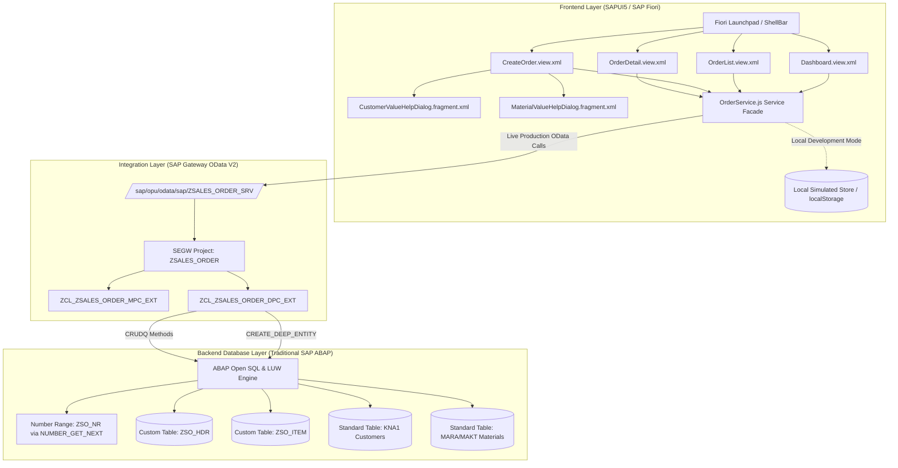

# 📦 Enterprise Sales Order Management System
### Architecture: Traditional SAP ABAP (SE11, SE38, SEGW, Open SQL) & SAP Fiori (SAPUI5 Horizon Theme)

[](https://ui5.sap.com/)
[](https://experience.sap.com/fiori-design/)
[-FF9800.svg?style=for-the-badge)](https://help.sap.com/)
[](https://help.sap.com/)
[-009688.svg?style=for-the-badge)](https://help.sap.com/)

---

## 📑 Table of Contents
1. [Project Overview & Business Objective](#1-project-overview--business-objective)
2. [End-to-End System Architecture](#2-end-to-end-system-architecture)
3. [Traditional SAP ABAP Backend Specifications](#3-traditional-sap-abap-backend-specifications)
   - [3.1 Database Tables (SE11)](#31-database-tables-se11)
   - [3.2 Domains & Data Elements](#32-domains--data-elements)
   - [3.3 Number Range Object (SNRO)](#33-number-range-object-snro)
   - [3.4 SAP Gateway Service Builder (SEGW)](#34-sap-gateway-service-builder-segw)
   - [3.5 ABAP OO Data Provider Class (DPC_EXT) Implementation](#35-abap-oo-data-provider-class-dpc_ext-implementation)
   - [3.6 Service Activation & Testing (/IWFND/MAINT_SERVICE & /IWFND/GW_CLIENT)](#36-service-activation--testing-iwfndmaint_service--iwfndgw_client)
4. [SAP Fiori Frontend Specifications (SAPUI5)](#4-sap-fiori-frontend-specifications-sapui5)
   - [4.1 UI5 Architecture & Directory Structure](#41-ui5-architecture--directory-structure)
   - [4.2 Screen-by-Screen Breakdown](#42-screen-by-screen-breakdown)
   - [4.3 Dynamic Client-Side Logic & Validations](#43-dynamic-client-side-logic--validations)
   - [4.4 Service Layer Design (OrderService.js)](#44-service-layer-design-orderservicejs)
5. [Database to Frontend Field Mapping Table](#5-database-to-frontend-field-mapping-table)
6. [How to Run the Application Locally](#6-how-to-run-the-application-locally)
7. [End-to-End Testing & Verification](#7-end-to-end-testing--verification)
8. [Interview Q&A Guide (How to Explain this Project)](#8-interview-qa-guide-how-to-explain-this-project)

---

## 1. Project Overview & Business Objective

The **Sales Order Management System** is a mission-critical enterprise application engineered to streamline the order-to-cash lifecycle for sales representatives and order fulfillment teams.

### Core Capabilities:
- **Executive Dashboard:** Real-time visibility into overall order counts, status breakdown (Open, Confirmed, Cancelled), total gross pipeline revenue, and recent order activity.
- **Search & Maintenance:** Fast filtering, multi-criteria search, sorting, and CSV data export.
- **Order Creation with Deep Entity Persistence:** Dynamic line items addition, instant customer/material search via Value Help dialogs, real-time calculations (Net Amount = Quantity × Unit Price, 19% VAT, Grand Total), and transactional saving.
- **Order Details & Lifecycle:** `ObjectHeader` summaries, commercial customer data, status transition workflows (*Confirm Order*, *Cancel Order*, *Edit Dialog*, *Delete Order*), and print preview.

> ⚠️ **Strict Architectural Boundary:** This system is built strictly using **Traditional SAP ABAP** (SE11, SE38, Open SQL, SEGW OData V2, DPC_EXT) and **SAPUI5**. It does **not** rely on ABAP RESTful Application Programming Model (RAP), CDS-based RAP business objects, OData V4 RAP services, React, Angular, or Vue.

---

## 2. End-to-End System Architecture



---

## 3. Traditional SAP ABAP Backend Specifications

All backend artifacts are located under the [`backend_abap/`](file:///Users/yogeshrajput/Desktop/sales%20order%20management/backend_abap) folder.

### 3.1 Database Tables (SE11)
The backend database is structured around two transparent tables with foreign key referential integrity:

#### A. Table `ZSO_HDR` (Sales Order Header)
* **Transaction:** `SE11` -> Database Table
* **Delivery Class:** `A` (Application table)
* **Data Class:** `APPL0` | **Size Category:** `1`
* **Buffering:** Allowed, switched off (Transaction Table)

```sql
CREATE TABLE zso_hdr (
  mandt      TYPE mandt        NOT NULL,  -- Client (Key)
  vbeln      TYPE zde_vbeln    NOT NULL,  -- Sales Order ID (Key, CHAR 10)
  kunnr      TYPE kunnr        NOT NULL,  -- Customer ID (CHAR 10)
  erdat      TYPE erdat        NOT NULL,  -- Creation Date (DATS 8)
  status     TYPE zde_status   NOT NULL,  -- Status: 'O'=Open, 'C'=Confirmed, 'X'=Cancelled
  waerk      TYPE waers,                  -- Document Currency (CUKY 5)
  netwr      TYPE zde_netwr,              -- Net Total Value (CURR 15,2, Ref: WAERK)
  remarks    TYPE char255,                -- Notes / Instructions (CHAR 255)
  ernam      TYPE ernam,                  -- Created By User (UNAME)
  erzet      TYPE erzet,                  -- Creation Time (TIMS 6)
  aedat      TYPE aedat,                  -- Last Change Date (DATS 8)
  aenam      TYPE aenam,                  -- Last Changed By (UNAME)
  PRIMARY KEY (mandt, vbeln)
);
```

#### B. Table `ZSO_ITEM` (Sales Order Line Items)
* **Transaction:** `SE11` -> Database Table
* **Delivery Class:** `A` (Application table)
* **Foreign Key:** `ZSO_ITEM-MANDT = ZSO_HDR-MANDT` AND `ZSO_ITEM-VBELN = ZSO_HDR-VBELN` (Cardinality `1 : N`)

```sql
CREATE TABLE zso_item (
  mandt      TYPE mandt        NOT NULL,  -- Client (Key)
  vbeln      TYPE zde_vbeln    NOT NULL,  -- Sales Order ID (Key, CHAR 10)
  posnr      TYPE zde_posnr    NOT NULL,  -- Item Number (Key, NUMC 6, e.g. 000010)
  matnr      TYPE matnr        NOT NULL,  -- Material ID (CHAR 18)
  arktx      TYPE arktx,                  -- Short Description (CHAR 40)
  kwmeng     TYPE zde_menge,              -- Cumulative Order Qty (QUAN 13,3, Ref: VRKME)
  vrkme      TYPE vrkme,                  -- Sales Unit of Measure (UNIT 3)
  netpr      TYPE zde_netwr,              -- Unit Price (CURR 15,2, Ref: WAERK)
  netwr      TYPE zde_netwr,              -- Net Amount = Qty * UnitPrice (CURR 15,2)
  waerk      TYPE waers,                  -- Currency Key (CUKY 5)
  PRIMARY KEY (mandt, vbeln, posnr)
);
```

---

### 3.2 Domains & Data Elements

| Object Name | Object Type | Technical Type | Description / Fixed Values |
| :--- | :--- | :--- | :--- |
| **`ZDO_VBELN`** | Domain | `CHAR 10` | Sales Order Number (Conversion Exit `ALPHA`) |
| **`ZDO_POSNR`** | Domain | `NUMC 6` | Sales Order Item Number |
| **`ZDO_STATUS`** | Domain | `CHAR 1` | Status Flag: `'O'` = Open, `'C'` = Confirmed, `'X'` = Cancelled |
| **`ZDE_VBELN`** | Data Element | `ZDO_VBELN` | Field Labels: *Order* (10), *Sales Order ID* (20) |
| **`ZDE_POSNR`** | Data Element | `ZDO_POSNR` | Field Labels: *Item* (6), *Sales Item* (20) |
| **`ZDE_STATUS`** | Data Element | `ZDO_STATUS` | Field Labels: *Stat* (4), *Order Status* (20) |
| **`ZDE_NETWR`** | Data Element | `WERTV8` | Net Document Value (Currency Ref: `WAERK`) |
| **`ZDE_MENGE`** | Data Element | `MENG13` | Sales Order Quantity (Unit Ref: `VRKME`) |

---

### 3.3 Number Range Object (SNRO)
Sequential document numbers are generated centrally via standard SAP Number Range management:
* **Transaction:** `SNRO`
* **Object Name:** `ZSO_NR`
* **Number Length Domain:** `ZDO_VBELN` (10 characters)
* **Interval 01:**
  * From Number: `0000001000`
  * To Number: `0000009999`
  * Current Number: `0000001006`
  * External: `[ ]` (Internal automatic numbering)
* **Function Module:** `NUMBER_GET_NEXT` called inside ABAP DPC_EXT.

---

### 3.4 SAP Gateway Service Builder (SEGW)
* **Transaction:** `SEGW`
* **Project Name:** `ZSALES_ORDER`
* **Technical Service Name:** `ZSALES_ORDER_SRV` (Version 1)

#### Entity Model Setup:
1. **`SalesOrderHeader`** (Key: `Vbeln`) -> Entity Set: `SalesOrderHeaderSet`
2. **`SalesOrderItem`** (Key: `Vbeln`, `Posnr`) -> Entity Set: `SalesOrderItemSet`
3. **`Customer`** (Key: `Kunnr`) -> Entity Set: `CustomerSet` (Value Help)
4. **`Material`** (Key: `Matnr`) -> Entity Set: `MaterialSet` (Value Help)
5. **Association & Navigation:**
   * Association: `Assoc_Header_Item` (Principal: `SalesOrderHeader` [1] <-> Dependent: `SalesOrderItem` [*])
   * Navigation Property on Header: `ToItems`
   * Navigation Property on Item: `ToHeader`

---

### 3.5 ABAP OO Data Provider Class (DPC_EXT) Implementation
* **Class:** `ZCL_ZSALES_ORDER_DPC_EXT` (inherits from `ZCL_ZSALES_ORDER_DPC`)
* **Source Code:** [backend_abap/ZCL_ZSALES_ORDER_DPC_EXT.abap](file:///Users/yogeshrajput/Desktop/sales%20order%20management/backend_abap/ZCL_ZSALES_ORDER_DPC_EXT.abap)

#### Key Method Redefinitions:

1. **`CREATE_DEEP_ENTITY` (Transactional Deep Insert):**
   Handles atomic creation of Header (`ZSO_HDR`) and all Line Items (`ZSO_ITEM`) in a single SAP Logical Unit of Work (LUW).
   ```abap
   METHOD /iwbep/if_mgw_appl_srv_runtime~create_deep_entity.
     " 1. Deserialize nested Header + ToItems payload
     io_data_provider->read_entry_data( IMPORTING es_data = ls_deep_payload ).

     " 2. Automatic Number Generation via SNRO
     IF ls_deep_payload-vbeln IS INITIAL.
       CALL FUNCTION 'NUMBER_GET_NEXT'
         EXPORTING nr_range_nr = '01' object = 'ZSO_NR'
         IMPORTING number = lv_new_vbeln.
     ENDIF.

     " 3. Validate positive quantities and calculate line amounts
     LOOP AT ls_deep_payload-to_items ASSIGNING <ls_item>.
       <ls_item>-net_amount = <ls_item>-qty * <ls_item>-unit_price.
       lv_total_amount = lv_total_amount + <ls_item>-net_amount.
       APPEND ls_item_db TO lt_item_db.
     ENDLOOP.

     " 4. Transactional Inserts via Open SQL
     INSERT zso_hdr FROM @ls_hdr_db.
     INSERT zso_item FROM TABLE @lt_item_db.

     " 5. Check LUW execution
     IF sy-subrc = 0.
       COMMIT WORK AND WAIT.
     ELSE.
       ROLLBACK WORK.
       RAISE EXCEPTION TYPE /iwbep/cx_mgw_busi_exception ...
     ENDIF.
   ENDMETHOD.
   ```

2. **`SALESORDERHEADER_GET_ENTITYSET`:**
   Queries `ZSO_HDR` with filter criteria (`STATUS`, `KUNNR`, `ERDAT`), paging (`$top`, `$skip`), enriches customer names from standard table `KNA1`, and calculates line item counts dynamically.
3. **`SALESORDERHEADER_GET_ENTITY`:**
   Retrieves a single order header by `VBELN` with error handling (`/IWBEP/CX_MGW_BUSI_EXCEPTION=>RESOURCE_NOT_FOUND`).
4. **`SALESORDERHEADER_UPDATE_ENTITY`:**
   Updates order status and header remarks in `ZSO_HDR` with `COMMIT WORK AND WAIT`.
5. **`SALESORDERHEADER_DELETE_ENTITY`:**
   Transactional cascade delete: removes line items from `ZSO_ITEM` first, then removes header from `ZSO_HDR`.
6. **`SALESORDERITEM_GET_ENTITYSET`:**
   Retrieves items for an order, supporting navigation `/SalesOrderHeaderSet('1001')/ToItems` or direct queries.
7. **`CUSTOMER_GET_ENTITYSET` & `MATERIAL_GET_ENTITYSET`:**
   Master data queries on `KNA1` and `MARA`/`MAKT` for F4 Value Help dialogs.

---

### 3.6 Service Activation & Testing (/IWFND/MAINT_SERVICE & /IWFND/GW_CLIENT)

1. **Activate Service:**
   * Open Transaction `/IWFND/MAINT_SERVICE`.
   * Click **Add Service**, select System Alias `LOCAL`, find `ZSALES_ORDER_SRV`, and activate.
2. **Execute Gateway Client (`/IWFND/GW_CLIENT`):**
   * Service Document: `GET /sap/opu/odata/sap/ZSALES_ORDER_SRV/?$format=json`
   * Metadata: `GET /sap/opu/odata/sap/ZSALES_ORDER_SRV/$metadata`
   * Query Orders: `GET /sap/opu/odata/sap/ZSALES_ORDER_SRV/SalesOrderHeaderSet?$top=5&$format=json`
   * Expand Line Items: `GET /sap/opu/odata/sap/ZSALES_ORDER_SRV/SalesOrderHeaderSet('0000001001')?$expand=ToItems&$format=json`

---

## 4. SAP Fiori Frontend Specifications (SAPUI5)

### 4.1 UI5 Architecture & Directory Structure
```text
webapp/
├── Component.js                       # Root UIComponent: models, routing, OrderService initialization
├── index.html                         # SAPUI5 Bootstrap with SAP Horizon theme
├── manifest.json                      # Application descriptor: routing, models, OData dataSources
├── controller/
│   ├── App.controller.js              # ShellBar navigation & demo data reset
│   ├── BaseController.js              # Shared controller utilities (routing, i18n, MessageToast/Box)
│   ├── CreateOrder.controller.js      # Dynamic line items, live calculations, validations
│   ├── Dashboard.controller.js        # KPI cards, metrics aggregation & recent orders
│   ├── OrderDetail.controller.js      # ObjectHeader, status lifecycle, edit dialog, deletion
│   └── OrderList.controller.js        # SearchField, status filtering, table sorting, CSV export
├── view/
│   ├── App.view.xml                   # Root ShellBar layout
│   ├── CreateOrder.view.xml           # Header form, items table, summary box
│   ├── Dashboard.view.xml             # KPI cards, metrics grid, recent orders table
│   ├── OrderDetail.view.xml           # ObjectHeader, customer section, item table
│   └── OrderList.view.xml             # FilterBar, responsive table, action buttons
├── fragment/
│   ├── CustomerValueHelpDialog.fragment.xml  # TableSelectDialog for customer selection
│   ├── EditOrderDialog.fragment.xml          # Edit order status and notes dialog
│   └── MaterialValueHelpDialog.fragment.xml  # TableSelectDialog for material selection
├── model/
│   ├── formatter.js                   # Status badges, currency, quantity, date formatters
│   └── models.js                      # Device & app view state models
├── service/
│   └── OrderService.js                # Dedicated service facade (Mock DB & Gateway OData V2)
├── localService/
│   ├── metadata.xml                   # OData V2 EDMX schema matching ZSALES_ORDER_SRV
│   └── mockdata/
│       ├── Customers.json             # Customer master records
│       ├── Materials.json             # Material master records
│       ├── SalesOrderHeaders.json     # Initial headers (ZSO_HDR)
│       └── SalesOrderItems.json       # Initial line items (ZSO_ITEM)
├── i18n/
│   └── i18n.properties                # Enterprise translation texts & labels
└── css/
    └── style.css                      # SAP Horizon styling enhancements
```

---

### 4.2 Screen-by-Screen Breakdown

#### Screen A: Sales Order Dashboard
* **Route:** `""` | **View:** [Dashboard.view.xml](file:///Users/yogeshrajput/Desktop/sales%20order%20management/webapp/view/Dashboard.view.xml)
* **Metrics:** 5 KPI cards showing Total Orders, Open Orders, Confirmed Orders, Cancelled Orders, and Total Value.
* **Interactive Table:** Displays latest orders with status indicators, item badges, and drill-down navigation.
* **Quick Actions:** Create New Order and View All Orders.

#### Screen B: Sales Order List
* **Route:** `"orders"` | **View:** [OrderList.view.xml](file:///Users/yogeshrajput/Desktop/sales%20order%20management/webapp/view/OrderList.view.xml)
* **FilterBar:** Real-time SearchField (debounced at 300ms) matching Order ID, Customer ID, or Name. Status dropdown filter (`ALL`, `O`, `C`, `X`).
* **Table Features:** `sap.m.Table` with responsive columns, `ObjectIdentifier`, `ObjectStatus` with semantic colors, Sort Order toggle, and **Export to CSV**.

#### Screen C: Create Sales Order
* **Route:** `"create"` | **View:** [CreateOrder.view.xml](file:///Users/yogeshrajput/Desktop/sales%20order%20management/webapp/view/CreateOrder.view.xml)
* **Header Form:** Order ID (optional manual entry or auto-generated), Customer ID with F4 Value Help dialog, Order Date, Initial Status, and Remarks.
* **Dynamic Items Table:** Add Item, Delete Item, Material ID with F4 Value Help dialog, auto-filled description and unit price.
* **Live Calculation:** Net Amount (`Qty × UnitPrice`), Subtotal, 19% Tax, and Grand Total update instantaneously on client-side input change.

#### Screen D: Sales Order Details
* **Route:** `"orders/{vbeln}"` | **View:** [OrderDetail.view.xml](file:///Users/yogeshrajput/Desktop/sales%20order%20management/webapp/view/OrderDetail.view.xml)
* **ObjectHeader:** Prominently displays Customer Name, Order ID, Gross Total, Order Date, and Semantic Status badge.
* **Customer Card:** Contact information, location, credit limit, and payment terms.
* **Lifecycle Actions:** *Confirm Order* (Status -> `C`), *Cancel Order* (Status -> `X`), *Edit Dialog* (modal popup for notes and status), *Delete Order* (removes from both `ZSO_HDR` and `ZSO_ITEM`), and *Print Preview*.

#### Screen E: Value Help Dialogs
* **Customer Value Help:** [CustomerValueHelpDialog.fragment.xml](file:///Users/yogeshrajput/Desktop/sales%20order%20management/webapp/fragment/CustomerValueHelpDialog.fragment.xml) using `TableSelectDialog` with live multi-column filtering across ID, Name, and City.
* **Material Value Help:** [MaterialValueHelpDialog.fragment.xml](file:///Users/yogeshrajput/Desktop/sales%20order%20management/webapp/fragment/MaterialValueHelpDialog.fragment.xml) using `TableSelectDialog` displaying Material ID, Description, UoM, Unit Price, and Stock Available levels.

---

### 4.3 Dynamic Client-Side Logic & Validations
Implemented inside [CreateOrder.controller.js](file:///Users/yogeshrajput/Desktop/sales%20order%20management/webapp/controller/CreateOrder.controller.js):
* **Automatic Recalculations:**
  $$\text{Net Amount} = \text{Quantity} \times \text{Unit Price}$$
  $$\text{Subtotal} = \sum \text{Net Amount}, \quad \text{Tax (19\%)} = \text{Subtotal} \times 0.19, \quad \text{Grand Total} = \text{Subtotal} + \text{Tax}$$
* **Validation Rules:**
  1. Mandatory Customer Selection (`KUNNR`).
  2. Mandatory Order Date (`ERDAT`).
  3. Document must contain at least 1 line item.
  4. Positive quantities (`Qty > 0`) and valid unit prices.
  5. Unique line item numbers (`POSNR`) to prevent primary key collision in `ZSO_ITEM`.

---

### 4.4 Service Layer Design (OrderService.js)
Implemented in [webapp/service/OrderService.js](file:///Users/yogeshrajput/Desktop/sales%20order%20management/webapp/service/OrderService.js):
* **Separation of Concerns:** UI controllers never make direct HTTP calls; they interact strictly with the `OrderService` abstraction.
* **Local Development Persistence:** Implements simulated CRUDQ with `localStorage` persistence, allowing full testing of create, read, update, and delete workflows offline.
* **Gateway Production Switching:** When connected to an active SAP Gateway, calls route directly to `sap.ui.model.odata.v2.ODataModel`.

---

## 5. Database to Frontend Field Mapping Table

### A. Sales Order Header (`ZSO_HDR`) -> OData Entity `SalesOrderHeader`

| Backend Field | Data Element | Data Type | Length | Frontend Property | UI5 Control | Notes |
| :--- | :--- | :--- | :--- | :--- | :--- | :--- |
| **`MANDT`** [PK] | `MANDT` | `CLNT` | 3 | *(Implicit)* | *(Session)* | Managed by Gateway |
| **`VBELN`** [PK] | `ZDE_VBELN` | `CHAR` | 10 | `Vbeln` | `sap.m.ObjectIdentifier` / `Input` | Sales Order ID |
| **`KUNNR`** | `KUNNR` | `CHAR` | 10 | `Kunnr` | `sap.m.Input` | Customer ID (with F4 Help) |
| **`ERDAT`** | `ERDAT` | `DATS` | 8 | `Erdat` | `sap.m.DatePicker` | Creation Date |
| **`STATUS`** | `ZDE_STATUS` | `CHAR` | 1 | `Status` | `sap.m.ObjectStatus` / `Select` | `'O'`, `'C'`, `'X'` |
| **`WAERK`** | `WAERS` | `CUKY` | 5 | `Currency` | Currency Code | e.g. `EUR`, `USD` |
| **`NETWR`** | `ZDE_NETWR` | `CURR` | 15,2 | `TotalAmount` | `sap.m.ObjectNumber` / `Title` | Total Net Document Value |
| **`REMARKS`** | `CHAR255` | `CHAR` | 255 | `Remarks` | `sap.m.TextArea` / `Text` | Header Notes |
| **`ERNAM`** | `ERNAM` | `CHAR` | 12 | *(Audit)* | *(Backend)* | Created By (`sy-uname`) |
| **`ERZET`** | `TIME` | `TIMS` | 6 | *(Audit)* | *(Backend)* | Creation Time (`sy-uzeit`) |

### B. Sales Order Item (`ZSO_ITEM`) -> OData Entity `SalesOrderItem`

| Backend Field | Data Element | Data Type | Length | Frontend Property | UI5 Control | Notes |
| :--- | :--- | :--- | :--- | :--- | :--- | :--- |
| **`MANDT`** [PK] | `MANDT` | `CLNT` | 3 | *(Implicit)* | *(Session)* | Managed by Gateway |
| **`VBELN`** [PK] | `ZDE_VBELN` | `CHAR` | 10 | `Vbeln` | Foreign Key | References `ZSO_HDR-VBELN` |
| **`POSNR`** [PK] | `ZDE_POSNR` | `NUMC` | 6 | `Posnr` | `sap.m.Input` / `Text` | e.g. `000010`, `000020` |
| **`MATNR`** | `MATNR` | `CHAR` | 18 | `Matnr` | `sap.m.Input` | Material ID (with F4 Help) |
| **`ARKTX`** | `ARKTX` | `CHAR` | 40 | `Maktx` | `sap.m.Input` / `Text` | Material Description |
| **`KWMENG`** | `ZDE_MENGE` | `QUAN` | 13,3 | `Qty` | `sap.m.Input` (Type Number) | Order Quantity |
| **`VRKME`** | `VRKME` | `UNIT` | 3 | `Meins` | `sap.m.Text` | Sales Unit (`EA`, `PC`, `M`) |
| **`NETPR`** | `ZDE_NETWR` | `CURR` | 15,2 | `UnitPrice` | `sap.m.Input` (Type Number) | Price per unit |
| **`NETWR`** | `ZDE_NETWR` | `CURR` | 15,2 | `NetAmount` | `sap.m.ObjectNumber` | Calculated (`Qty × UnitPrice`) |
| **`WAERK`** | `WAERS` | `CUKY` | 5 | `Waers` | Currency Key | e.g. `EUR` |

---

## 6. How to Run the Application Locally

### Prerequisites
* **Node.js** (v16.0.0 or higher)
* Web browser (Chrome, Edge, Firefox, or Safari)

### Installation & Launch Steps
```bash
# 1. Open terminal and navigate to the project root
cd "/Users/yogeshrajput/Desktop/sales order management"

# 2. Launch the local HTTP development server
npm start
```

### Accessing the System
Open your browser and navigate to:
```
http://localhost:8080/index.html
```

---

## 7. End-to-End Testing & Verification

### A. Testing via the Fiori Web Interface
1. **Create Order:** Navigate to *Create Sales Order*, select customer `10000001` and material `MAT-00101`, input quantity `5`, verify calculated net amount (`7,250.00 EUR`), and click **Save Order**.
2. **Read Order:** In *Sales Orders*, verify the new order appears in the list. Click on the row to inspect full line items in *Sales Order Details*.
3. **Update Status:** On the detail page, click **Confirm Order** to change the status badge to green `Confirmed`. Use **Edit** to modify remarks.
4. **Delete Order:** Click **Delete**, confirm the prompt, and verify that the order is removed from both `ZSO_HDR` and `ZSO_ITEM`.

### B. Testing via SAP Gateway Client (`/IWFND/GW_CLIENT`)
* **HTTP Method:** `POST`
* **URI:** `/sap/opu/odata/sap/ZSALES_ORDER_SRV/SalesOrderHeaderSet`
* **Payload:**
```json
{
  "Vbeln": "",
  "Kunnr": "10000001",
  "Erdat": "/Date(1793019600000)/",
  "Status": "O",
  "Currency": "EUR",
  "Remarks": "Urgent plant maintenance order",
  "ToItems": [
    {
      "Posnr": "000010",
      "Matnr": "MAT-00101",
      "Maktx": "Industrial Servo Motor 5.5kW High-Torque",
      "Qty": "4.000",
      "Meins": "EA",
      "UnitPrice": "1450.00",
      "Waers": "EUR"
    },
    {
      "Posnr": "000020",
      "Matnr": "MAT-00102",
      "Maktx": "Precision Planetary Gearbox Ratio 10:1",
      "Qty": "2.000",
      "Meins": "EA",
      "UnitPrice": "680.00",
      "Waers": "EUR"
    }
  ]
}
```
* **Expected Response:** `HTTP 201 Created` with generated `Vbeln`, computed `TotalAmount`, and populated items.

---

## 8. Interview Q&A Guide (How to Explain this Project)

### Elevator Pitch (30 Seconds):
> *"I developed an enterprise Sales Order Management application using **SAP Fiori on the frontend** and **Traditional SAP ABAP with SAP Gateway on the backend**.*
> 
> *The application allows sales reps to manage orders through a dashboard, responsive list, dynamic order creation wizard, and detailed order lifecycle views. On the backend, I designed custom SE11 tables `ZSO_HDR` and `ZSO_ITEM`, implemented number range generation via `SNRO`, and built an OData V2 service in `SEGW`. To ensure complete transactional integrity, I implemented `CREATE_DEEP_ENTITY` in class `ZCL_ZSALES_ORDER_DPC_EXT` to persist Header and Line Items atomically in a single SAP LUW with Open SQL."*

### Key Technical Questions & Answers:

#### Q1: Why Traditional ABAP instead of RAP?
> **Answer:** *"Our target landscape is standard ECC / on-premise S/4HANA where core logistics processes rely on Traditional ABAP, Open SQL, and SAP Gateway. This approach provides fine-grained control over LUWs (`COMMIT WORK AND WAIT` / `ROLLBACK WORK`), custom numbering routines, and business exception mapping without requiring RAP/CDS infrastructure."*

#### Q2: How did you handle Header and Line Items in OData?
> **Answer:** *"Instead of sending separate POST requests for header and items, I implemented `/IWBEP/IF_MGW_APPL_SRV_RUNTIME~CREATE_DEEP_ENTITY` in `ZCL_ZSALES_ORDER_DPC_EXT`. The frontend sends a single nested JSON payload containing the header and `ToItems` array. The backend deserializes it, generates the order number via `NUMBER_GET_NEXT`, calculates line amounts, and inserts into `ZSO_HDR` and `ZSO_ITEM`. If any failure occurs, it issues `ROLLBACK WORK` to prevent orphan records."*

#### Q3: How is client-side performance optimized in SAPUI5?
> **Answer:** *"All mathematical calculations (Net Amount = Qty × Price, Subtotal, 19% VAT, Grand Total) are calculated in the UI5 JSON model in real time without making round-trips to the backend. In the list view, the search field includes a 300ms debounce timer, and backend queries utilize `$top` and `$skip` pagination."*

---

### 👨‍💻 Project Artifacts Reference
* **SE11 Definitions:** [`backend_abap/SE11_DICTIONARY.sql`](file:///Users/yogeshrajput/Desktop/sales%20order%20management/backend_abap/SE11_DICTIONARY.sql)
* **SEGW Gateway Guide:** [`backend_abap/SEGW_GUIDE.md`](file:///Users/yogeshrajput/Desktop/sales%20order%20management/backend_abap/SEGW_GUIDE.md)
* **ABAP DPC_EXT Class:** [`backend_abap/ZCL_ZSALES_ORDER_DPC_EXT.abap`](file:///Users/yogeshrajput/Desktop/sales%20order%20management/backend_abap/ZCL_ZSALES_ORDER_DPC_EXT.abap)
* **UI5 Manifest:** [`webapp/manifest.json`](file:///Users/yogeshrajput/Desktop/sales%20order%20management/webapp/manifest.json)
* **UI5 Service Layer:** [`webapp/service/OrderService.js`](file:///Users/yogeshrajput/Desktop/sales%20order%20management/webapp/service/OrderService.js)
